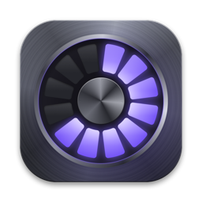
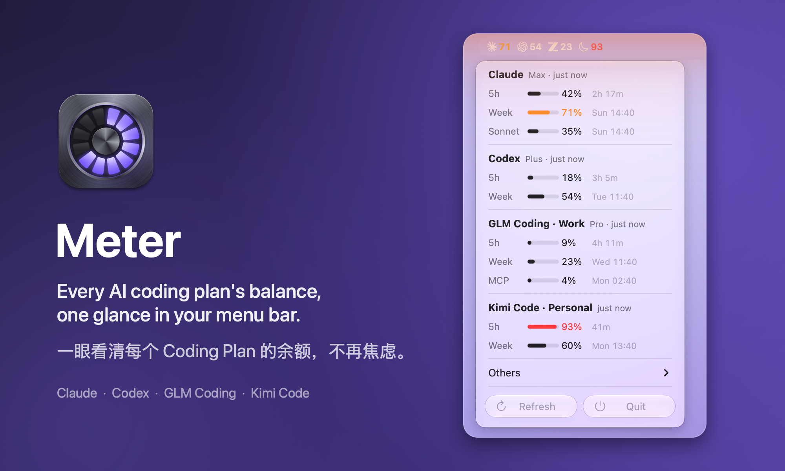
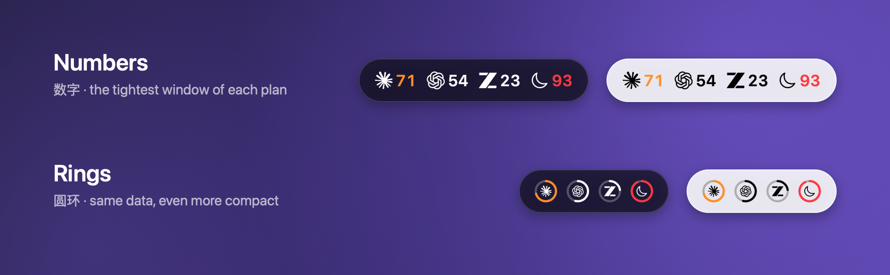

<p align="center">
  
</p>

<h1 align="center">Meter</h1>

<p align="center">
  <b>Every AI coding plan's balance — one glance in your menu bar.</b><br>
  一眼看清每个 AI Coding Plan 的余额，不再为额度焦虑。
</p>

<p align="center">
  Claude · Codex · GLM Coding Plan · Kimi Code<br>
  <a href="#english">English</a> · <a href="#中文">中文</a>
</p>

<p align="center">
  
</p>

---

## English

### Why Meter

If you pay for more than one AI coding plan, you know the feeling. Claude, Codex, GLM and Kimi
each meter you differently — 5-hour windows, weekly caps, monthly MCP quotas — and each hides the
numbers in a different settings page. So you either check four dashboards, or you don't, and find
out you're out of quota when the agent stops halfway through a refactor.

The uncertainty is the worst part: you either ration ("better save it for later") or burn through
it and keep worrying about hitting the wall.

**Meter puts every plan's remaining headroom in your menu bar.** One glance tells you which plan has
room right now and when each window resets — so you pick the right tool and get back to work.

### Features

- **All plans at a glance** — a monochrome logo and one number per plan. The number is the
  tightest window, i.e. the limit that will stop you first.
- **Colour only when it matters** — numbers turn orange at 70% and red at 90%.
- **Details on click** — every window with a progress bar, percentage and reset time. Click a plan's
  name to open its app; click a row to open its official usage page.
- **Multiple accounts** — add as many GLM Coding Plan / Kimi Code API keys as you like.
- **Keeps working** — Meter refreshes the Claude and Codex sign-ins by itself, keeps showing the last
  known numbers when a request fails, backs off politely on errors, refreshes after your Mac wakes,
  and offers one-click "Sign In Again" when a real re-login is needed.
- **Private** — talks only to each provider's own usage endpoint. Keys stay on your Mac. No analytics.
- **Native and tiny** — Swift + AppKit, no dependencies, Liquid Glass menu on macOS 26.

<p align="center">
  
</p>

Prefer something even smaller? Switch to **Rings** in *Others › Menu Bar Style*.

### Install

Requires macOS 13 or later on Apple silicon. Build from source (takes a few seconds):

```bash
git clone https://github.com/zjulhc-pixel/Meter.git && cd Meter && ./build.sh install
```

Then connect your plans:

| Plan | How to connect |
|---|---|
| Claude (Pro / Max) | Sign in to Claude Code once (`claude`). Meter reuses that sign-in. |
| Codex (ChatGPT plans) | Sign in to Codex once (Codex CLI or the ChatGPT app). |
| GLM Coding Plan | *Others › Accounts › Add GLM Coding Plan Account…* with your API key. |
| Kimi Code | *Others › Accounts › Add Kimi Code Account…* with your `sk-kimi-…` key. |

Meter turns on *Launch at Login* the first time it runs; toggle it under *Others*.

### Where the data comes from

| Plan | Credentials | Usage endpoint |
|---|---|---|
| Claude | Claude Code's keychain item `Claude Code-credentials` (or `~/.claude/.credentials.json`) | `api.anthropic.com/api/oauth/usage` |
| Codex | `~/.codex/auth.json` (`$CODEX_HOME`) | `chatgpt.com/backend-api/wham/usage` |
| GLM Coding | API key in `~/Library/Application Support/Meter/accounts.json` | `open.bigmodel.cn/api/monitor/usage/quota/limit` |
| Kimi Code | API key in the same file | `api.kimi.com/coding/v1/usages` |

Claude and Codex access tokens expire after a few hours. Meter refreshes them the same way the
official CLIs do and writes the new tokens back to the same place, so the CLIs keep working too.
Diagnostics (never containing secrets) go to `~/Library/Logs/Meter.log` (*Others › Open Log*).

### Development

```bash
./build.sh                    # build into build/Meter.app
./build.sh install            # replace /Applications/Meter.app and relaunch
build/Meter.app/Contents/MacOS/Meter --check   # fetch every plan once and print the results
build/Meter.app/Contents/MacOS/Meter --demo    # sample data, no network (add --rings / --backdrop)
swift Tools/make-icon.swift titanium Resources/AppIcon.icns   # regenerate the icon
swift Tools/make-icon.swift sheet styles.png  # compare icon materials: flat, aluminum, titanium, glass, obsidian
```

Formerly called UsageBar; the bundle id is still `local.usagebar` so existing settings carry over.

---

## 中文

### 为什么做 Meter

同时订阅了好几个 AI Coding Plan 的人，大概都有过这种感受：Claude、Codex、GLM、Kimi 各有各的计量方式——
5 小时窗口、周限额、MCP 月额度——用量还分散在各自的设置页里。要么一个个打开去看，要么干脆不看，
等到 agent 写到一半突然停下，才发现额度用完了。

最难受的是心里没底：要么舍不得用，总想"留着以后用"；要么放开用，又时刻担心随时撞上限额。

**Meter 把所有套餐的剩余额度放进菜单栏。** 扫一眼就知道哪个还有余量、各个窗口什么时候重置，
挑对工具接着干，不再为额度焦虑。

### 功能

- **一眼看全** —— 每个套餐一个黑白 logo 加一个数字。数字取最紧的那个窗口，也就是最先会卡住你的限额。
- **只在需要时提醒** —— 用量到 70% 数字变橙，到 90% 变红。
- **点开看详情** —— 每个窗口都有进度条、百分比和重置时间。点套餐名打开对应 app，点用量行打开官方用量页。
- **多账号** —— GLM Coding Plan 和 Kimi Code 可以添加任意多个 API key。
- **稳定不掉线** —— 自动刷新 Claude 和 Codex 的登录凭证；请求失败时继续显示上次的数据；出错时自动退避重试；
  电脑唤醒后立即刷新；真的需要重新登录时，菜单里一键 "Sign In Again"。
- **隐私** —— 只访问各家官方的用量接口，密钥只存在你的 Mac 上，没有任何统计上报。
- **原生轻量** —— Swift + AppKit，零依赖，macOS 26 上是 Liquid Glass 风格菜单。

<p align="center">
  
</p>

想要更短？在 *Others › Menu Bar Style* 里切到 **Rings（圆环）**。

### 安装

需要 macOS 13 及以上、Apple 芯片。从源码编译（几秒钟）：

```bash
git clone https://github.com/zjulhc-pixel/Meter.git && cd Meter && ./build.sh install
```

然后接入你的套餐：

| 套餐 | 接入方式 |
|---|---|
| Claude（Pro / Max） | 用 Claude Code 登录一次（运行 `claude`），Meter 直接复用这个登录。 |
| Codex（ChatGPT 套餐） | 登录一次 Codex（Codex CLI 或 ChatGPT app）。 |
| GLM Coding Plan | *Others › Accounts › Add GLM Coding Plan Account…*，填入 API key。 |
| Kimi Code | *Others › Accounts › Add Kimi Code Account…*，填入 `sk-kimi-…` 开头的 key。 |

Meter 首次运行会自动开启开机自启，可在 *Others* 里关闭。

### 数据来源

数据来源和凭证位置见上方英文部分的表格。Claude 和 Codex 的访问令牌几个小时就会过期，Meter 用和官方 CLI
相同的方式自动刷新，并写回原来的位置，所以 CLI 也能照常使用。诊断日志（不含任何密钥）在
`~/Library/Logs/Meter.log`（*Others › Open Log*）。

---

## License · 许可证

MIT — see [LICENSE](LICENSE). Meter is an independent project and is not affiliated with Anthropic,
OpenAI, Zhipu AI or Moonshot AI; product names and logos belong to their owners.

MIT 许可证，详见 [LICENSE](LICENSE)。Meter 是独立项目，与 Anthropic、OpenAI、智谱 AI、月之暗面均无关联，
产品名称和 logo 归各自所有者所有。
